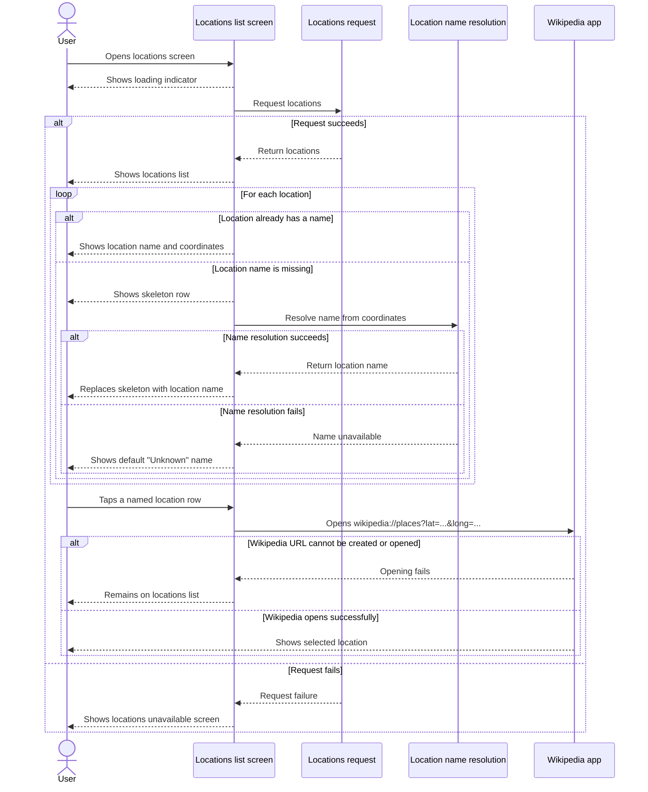
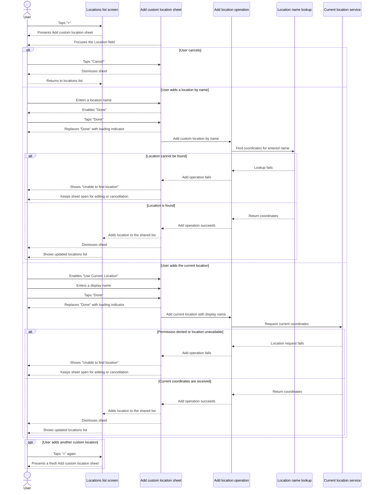

# LocationsList App 📍🌍
    This application shows locations list which come from custom endpoint. If name not come for specific city, application uses apple reverse geocoding to receive it based on coordinates.
    App has ability to add custom location with 2 different scenarios: 
1. based on city name - call apple geocoding api to receive coordinates 
2. based on current user location - resolve coordinates with CLLocationManager.

Once user tap on location - wikipedia app opens on Places tab and show corresponding location.

# Wikipedia app
Use this [Fork](https://github.com/allar5430/wikipedia-ios) with deeplink-navigation branch

## Application stack
- Swift 6
- SwiftUI
- Swift Concurrency
- MVVM + Router
- XCTest
- Accessibility
    - Dynamic Text Size
    - VoiceOver
- CoreLocation for geocoding
- os for logging

## Example of work
https://github.com/user-attachments/assets/1b5968f0-5c04-44a3-ad1e-1a7c56a3cba6

## Get Locations List UX

User-facing states:

- While the locations request is running, the screen shows a loading indicator.
- If the request succeeds, the locations list appears.
- Locations with known names show their name immediately.
- Locations without names show a skeleton row while name resolution is running.
- A successful name resolution replaces the skeleton with the resolved name.
- A failed name resolution replaces the skeleton with the default `Unknown` name.
- A failed initial locations request shows the locations unavailable screen.

## Add Custom Location UX

## Dark mode

## Large text

